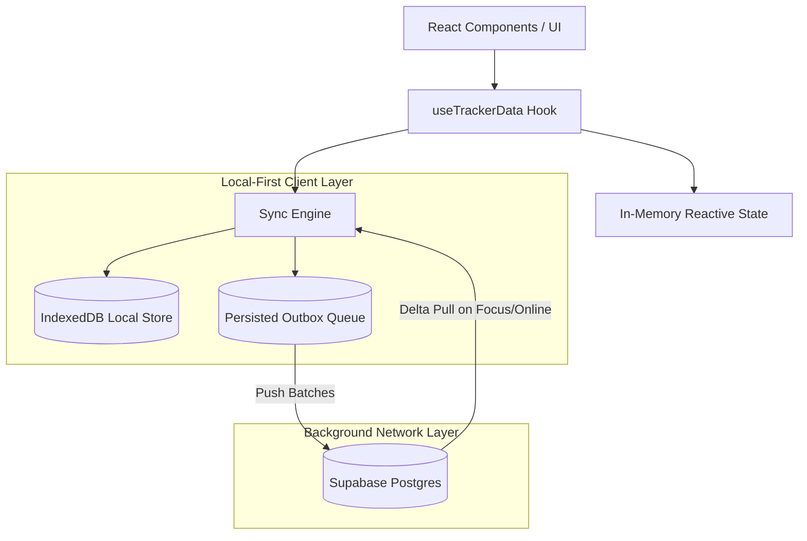

# PennyWise Sync Redesign: Local-First Per-Row Sync Engine

This specification outlines the transition of PennyWise from full-blob snapshot sync to a true local-first per-row synchronization engine backed by Supabase and client-side IndexedDB.

---

## 1. Problem Statement

### 1.1 Current Architecture & Limitations
1. **Whole-Blob Last-Write-Wins**: Every change debounces to write the entire application state into a single JSON column in `expense_tracker_data`. Edits from concurrent devices (e.g., mobile + laptop) silently overwrite each other.
2. **Offline Overwriting**: Offline edits are lost on reconnection if the remote blob is pulled without timestamp conflict resolution.
3. **Silent Failure & No Retry**: A network or authentication error marks data as "saved locally", but there is no retry outbox queue to push changes once connectivity is restored.
4. **Dead Normalized Schema**: `schema.sql` and `expenseService.js` describe normalized tables, but the active application bypasses them entirely. Furthermore, existing normalized schemas lack support for Transfers, Category Budgets, Credit Card billing/due cycles, and soft deletes.

---

## 2. Core Architecture

### 2.1 Principles
- **In-Memory UI Transparency**: The UI continues consuming the in-memory state exposed by `useTrackerData`. Zero changes required across page components (`Dashboard`, `History`, `Review`, `Settings`).
- **Server-Authoritative Timestamps**: All tables use server-assigned `updated_at = now()` triggers to eliminate client clock skew.
- **Tombstones (`deleted_at`)**: Records are soft-deleted with a timestamp so deletions propagate across all synced devices.
- **IndexedDB Storage**: Replaces `localStorage` (which is synchronous and capped at ~5MB) to handle years of transactions and persistent queue state safely.
- **Delta Sync Cursor**: Clients track `last_pulled_at` timestamps per table and fetch only rows modified since the cursor.

---

## 3. Database Schema (Migration v4)

### 3.1 New Tables
1. **`transfers`**:
   - `id` (text / uuid, primary key)
   - `user_id` (uuid, references auth.users)
   - `from_account_id` (text, not null)
   - `to_account_id` (text, not null)
   - `amount` (numeric, not null)
   - `date` (text / date, not null)
   - `note` (text)
   - `created_at` (timestamptz default now())
   - `updated_at` (timestamptz default now())
   - `deleted_at` (timestamptz)

2. **`category_budgets`**:
   - `id` (text, primary key — e.g. `${month}_${category}`)
   - `user_id` (uuid, references auth.users)
   - `month` (text, YYYY-MM)
   - `category` (text)
   - `amount` (numeric)
   - `updated_at` (timestamptz default now())
   - `deleted_at` (timestamptz)

### 3.2 Table Modifications
- Add `deleted_at timestamptz` to: `expenses`, `accounts`, `recurring_schedules`, `incomes`, `budgets`.
- Add `account_id text` to `incomes`.
- Add `billing_day integer`, `due_day integer` to `accounts`.
- Add `account_id text` to `recurring_schedules`.
- Add indexes on `(user_id, updated_at)` for efficient delta sync queries.
- Attach `moddatetime` or custom triggers to auto-update `updated_at = now()` on write.

---

## 4. Client Sync Engine (`src/sync/`)

### 4.1 Modules
- `idb.js`: Minimal IndexedDB wrapper for document state and mutation outbox.
- `outbox.js`: Enqueues operations `{ id, table, op: 'upsert' | 'delete', payload, createdAt }`.
- `syncClient.js`:
  - `push()`: Drains outbox entries in small batches to Supabase with exponential backoff.
  - `pull()`: Delta fetch (`updated_at > last_pulled_at`), updates local IndexedDB, merges into active memory.
  - `flush()`: Invoked on `visibilitychange` / `beforeunload` to push pending changes immediately.

### 4.2 Sync Status States
The status exposed to the UI:
- `synced`: All local changes successfully persisted to Supabase.
- `syncing`: Active network push/pull in flight.
- `pending`: Changes pending locally (offline or waiting to push).
- `error`: Network or server error with detailed message and manual "Retry Now" action.

---

## 5. Rollout Phases

- **Phase 0: Safety Net**: Comprehensive unit tests covering `normalizeData`, transfer balance reconciliation, and recurring expense expansion.
- **Phase 1: Schema v4**: Write `supabase/migration_v4_sync.sql` with idempotent table definitions, soft-delete columns, and triggers.
- **Phase 2: Local Engine**: Implement IndexedDB wrapper, outbox queue, and pull/push engine.
- **Phase 3: Hook Integration**: Wire `useTrackerData` to the engine, implement legacy blob one-time migration, and surface honest sync status.
- **Phase 4: Cleanup**: Remove orphaned `expenseService.js` and legacy whole-blob sync.

